# Refundavio

Refundavio is a native Android return and refund tracker designed for phones and Amazon Fire tablets. The first milestone focuses on the Refund Recovery Dashboard: how much is outstanding, what needs to go back soon, and which merchant needs a follow-up.

## Fire tablet screenshots

### English

| Refund tracker | Return deadlines | Warranty expiry |
| --- | --- | --- |
| 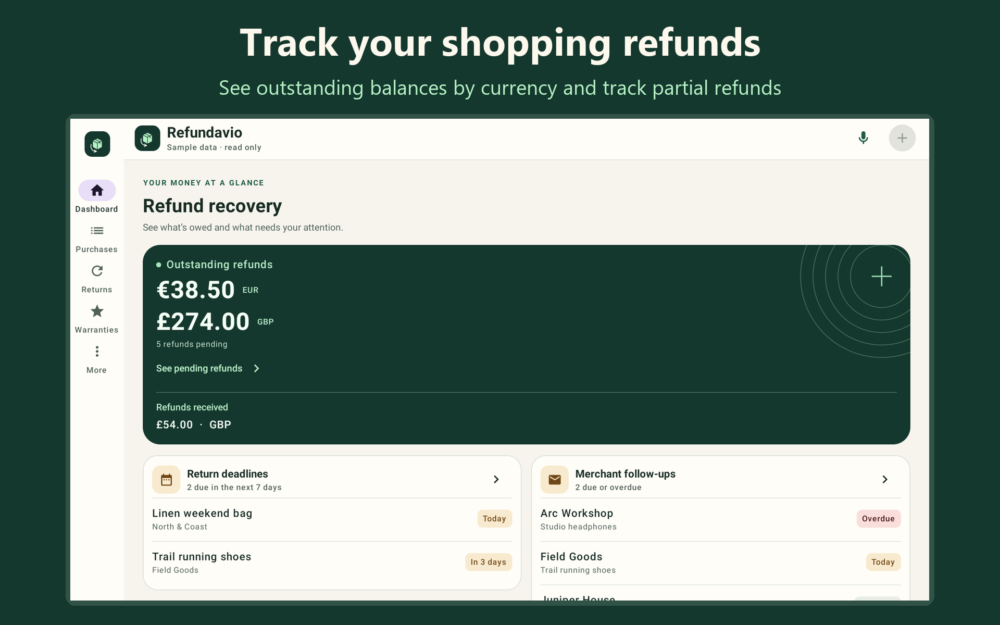 |  | 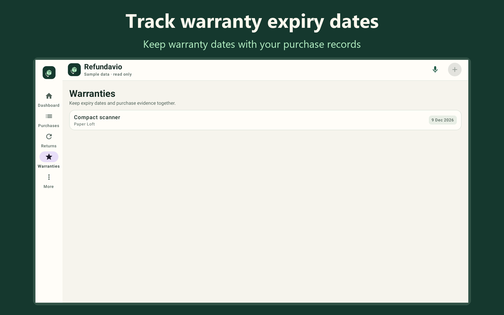 |

### English (Australia)

| Refund tracker | Return deadlines | Warranty expiry |
| --- | --- | --- |
|  | 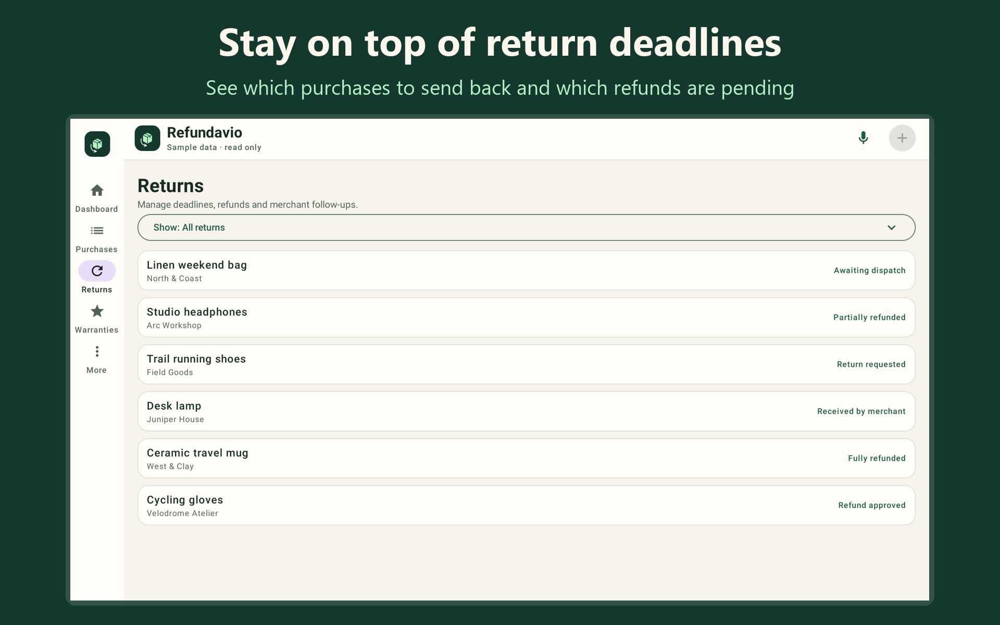 | 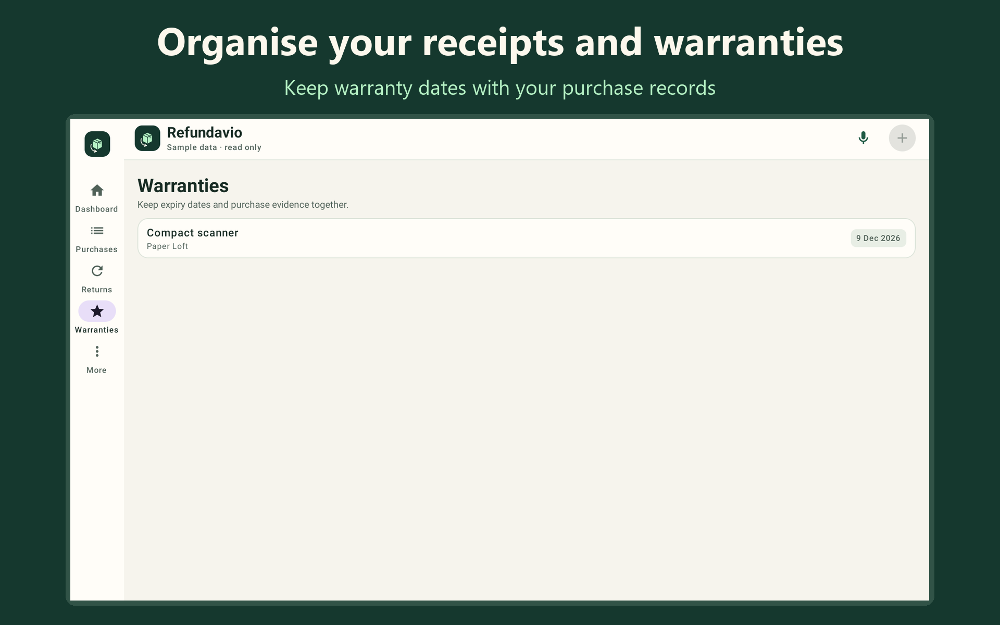 |

### English (UK)

| Refund tracker | Return deadlines | Warranty expiry |
| --- | --- | --- |
|  | 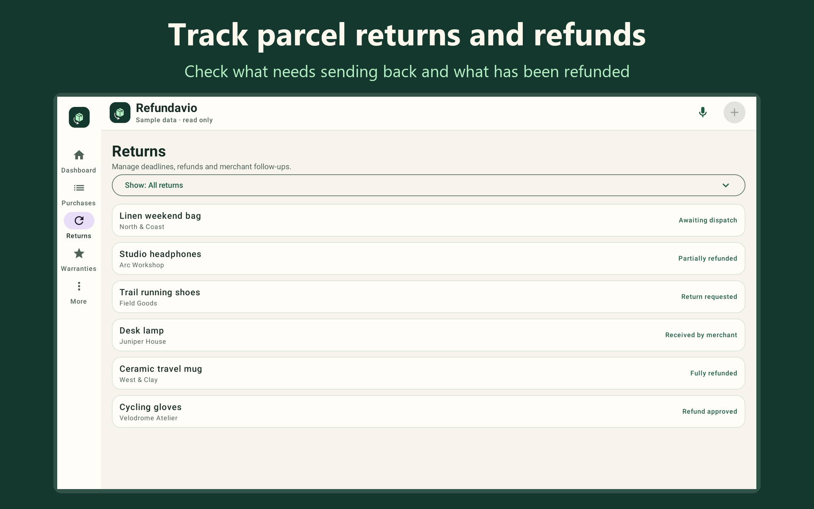 |  |

### English (India)

| Refund tracker | Return deadlines | Warranty expiry |
| --- | --- | --- |
|  |  |  |

### Español

| Seguimiento de reembolsos | Plazos de devolución | Vencimiento de garantías |
| --- | --- | --- |
| 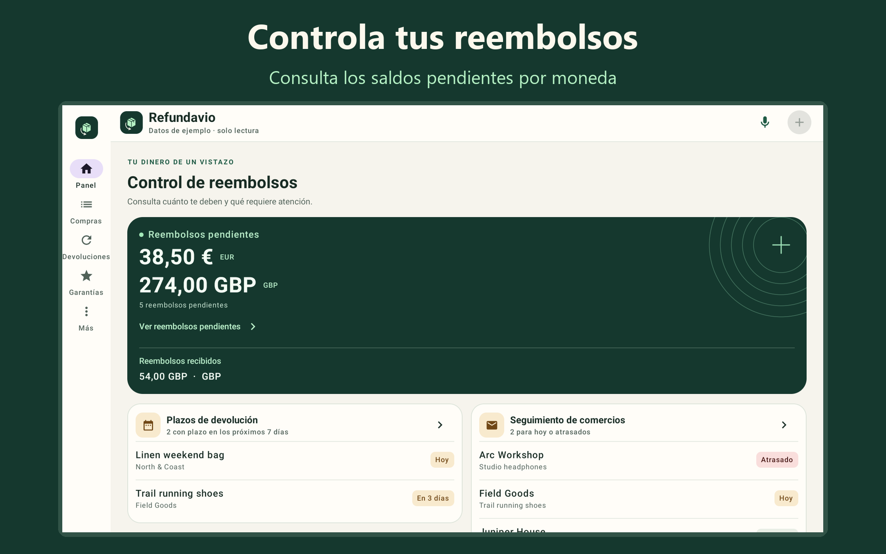 | 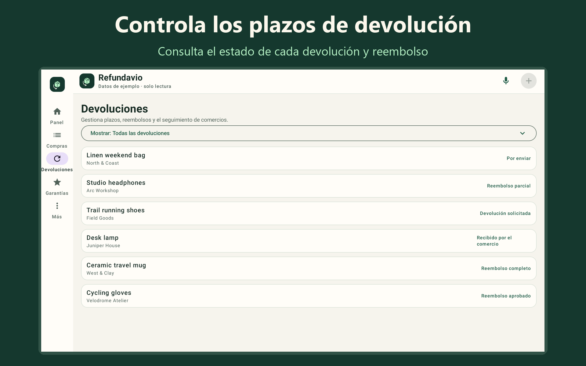 |  |

### Français

| Suivi des remboursements | Dates limites de retour | Dates de fin de garantie |
| --- | --- | --- |
| 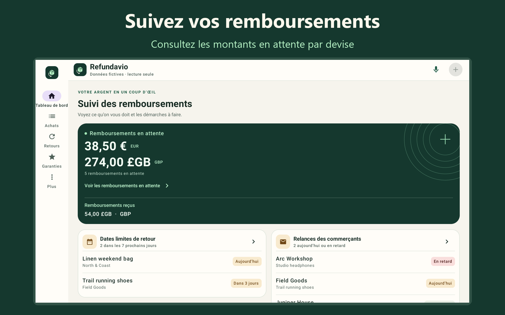 | 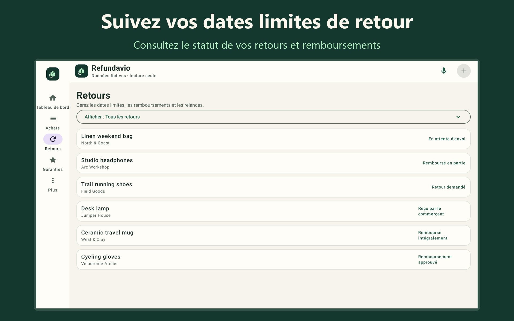 | 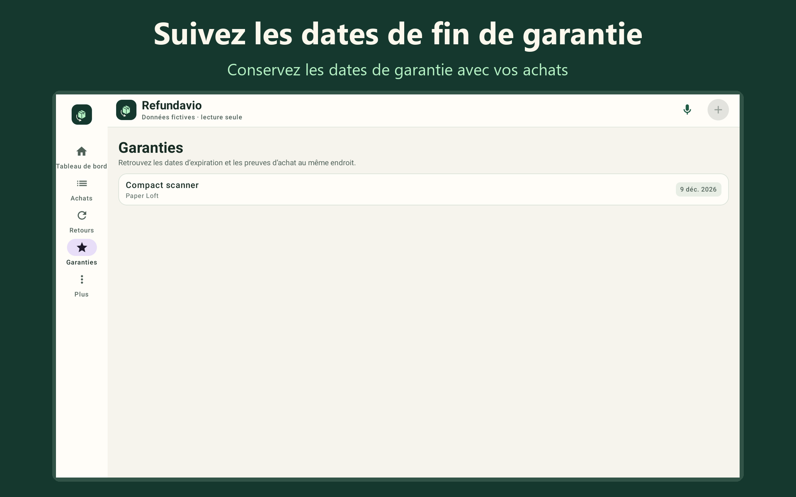 |

### Nederlands

| Terugbetalingen | Retouren | Garanties |
| --- | --- | --- |
| 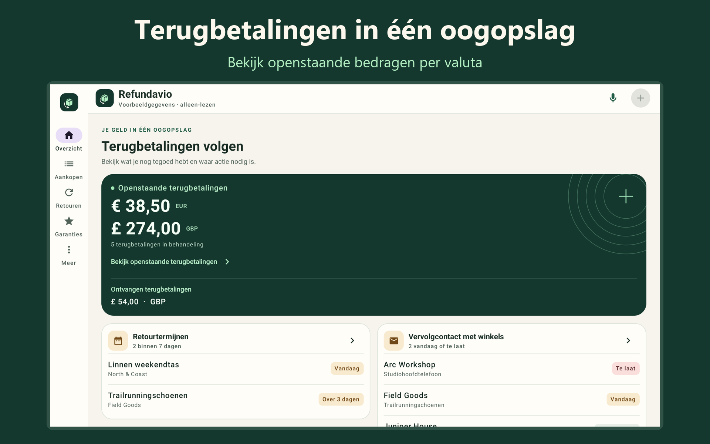 |  |  |

### Polski

| Zwroty pieniędzy | Zwroty | Gwarancje |
| --- | --- | --- |
| 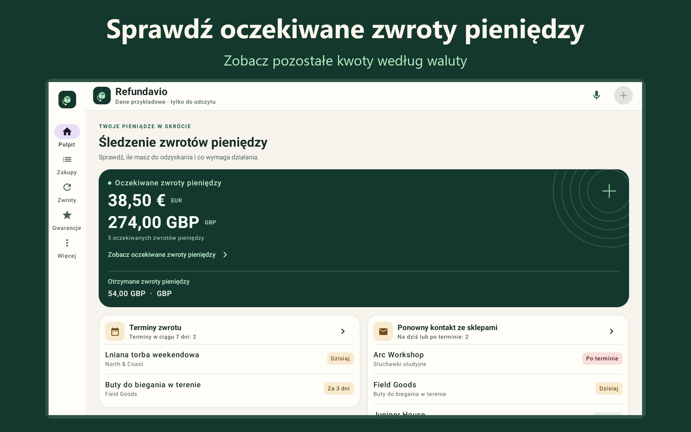 |  | 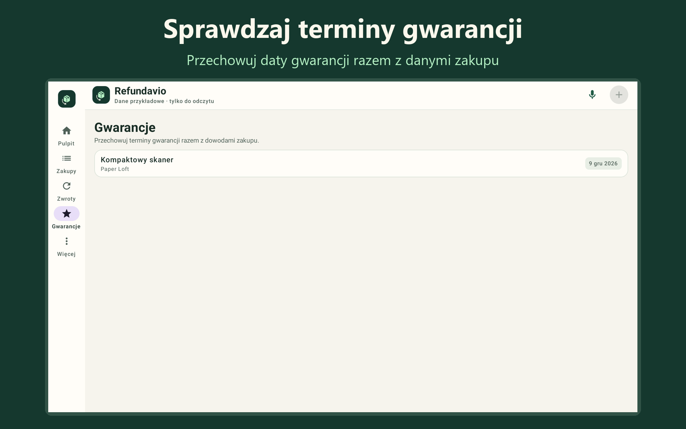 |

### Português (Portugal)

| Reembolsos | Devoluções | Garantias |
| --- | --- | --- |
|  |  |  |

### Svenska

| Återbetalningar | Returer | Garantier |
| --- | --- | --- |
| 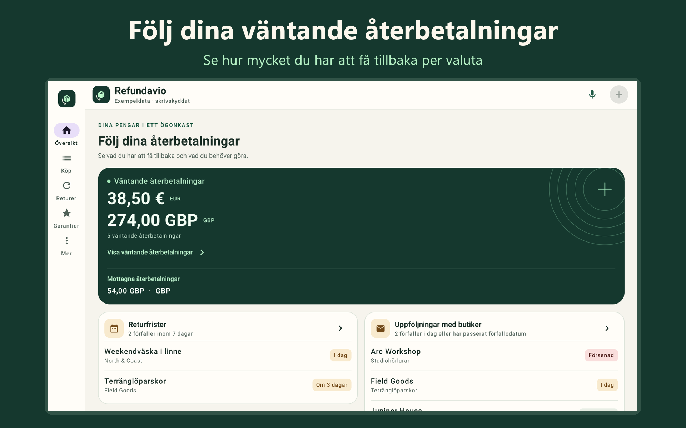 |  |  |

### العربية

| تتبّع الاسترداد | مواعيد الإرجاع | انتهاء الضمان |
| --- | --- | --- |
|  |  |  |

### हिन्दी

| रिफ़ंड का हिसाब | वापसी की तारीखें | वारंटी की तारीखें |
| --- | --- | --- |
| 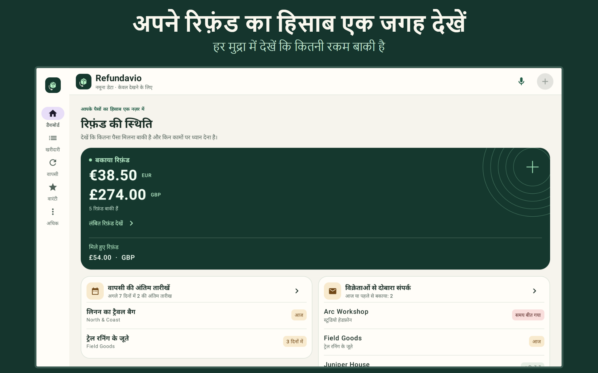 |  | 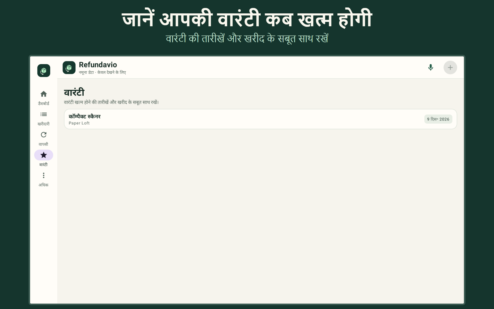 |

## Run and build

Install JDK 17 and Android SDK Platform 35 with Build Tools 35.0.0. Set `ANDROID_HOME` to the SDK directory or set `sdk.dir` in an untracked `local.properties`. The first build requires access to Google Maven and Maven Central. No credentials, backend, or `.env` file are required.

```powershell
.\gradlew.bat testDebugUnitTest assembleDebug assembleRelease
adb install -r app/build/outputs/apk/debug/app-debug.apk
```

Minimum API 26; target API 35. A release build is unsigned. The package name is `app.refundavio`; reserve the identifier and configure signing before distribution. Do not reuse another app’s signing key.

Run `./gradlew connectedDebugAndroidTest` on a fresh English-language Android test device or emulator to verify the dashboard journey and capture a sample dashboard image. The GitHub Actions workflow uses an 800 × 1280 Android 15 tablet emulator.

## Background reminders

Open **More → Background reminders**. Enable return deadlines and merchant follow-ups separately, and allow notifications when prompted. Choose one or more deadline lead times (7, 3, 1, or 0 days, plus a custom 0–30 day offset), and set the preferred time. For merchant follow-ups, Refundavio uses the next follow-up date saved on each return.

Reminders are opt-in and run offline. Android schedules them after the preferred local time, including when the app is closed; its power settings can delay delivery. A device restart or a clock or time-zone change rebuilds the schedule after Android allows the app to run. Android's **Force stop** action suspends delivery until the app is reopened. Notifications keep merchant names, items and amounts private. Tap a notification to open its dashboard queue.

To run the closed-app check on a personal device, build the isolated QA APKs, install both APKs with ADB, then run the test script. The script grants notifications to the QA package, schedules a real alarm, confirms the app process has exited, and checks Android's notification list without reopening the app.

```powershell
.\gradlew.bat -PrefundavioQa=true assembleDebug assembleDebugAndroidTest
adb install -r app/build/outputs/apk/debug/app-debug.apk
adb install -r app/build/outputs/apk/androidTest/debug/app-debug-androidTest.apk
pwsh -File scripts/test-closed-reminders.ps1
```

## Try the dashboard

- For a read-only tour, open **More → Preview sample dashboard**. Sample purchases never enter the local ledger.
- For your own data, tap **Add purchase**. Record the item, merchant, expected refund and relevant status or dates. Return deadlines are entered by you.
- Open a pending refund and choose **Record a refund received** to record each confirmed payment. Open a merchant follow-up to log contact, move the date, or prepare an editable draft you can copy. The app does not contact merchants.
- Return records stay separate by currency. No exchange rates are assumed. Closed, cancelled and rejected cases stop contributing to the outstanding amount; confirmed payments remain in received totals. Removing an incorrect payment recalculates the balance.

## Architecture

Compose renders five destinations with a navigation rail on wider displays. An Activity-scoped ViewModel observes a Room ledger. Purchase records, confirmed payments and contact entries are related by foreign keys. Ledger writes are transactional. The dashboard projection uses integer minor units for amounts and arbitrary precision decimal totals. It derives balances and urgency from saved amounts, dates and statuses, without calling an external service.

The purchase editor includes warranty expiry, optional parcel details and one Android document-picker attachment. Files remain with their selected provider. Voice shortcuts accept selected, typed or device-recognised commands for outstanding refunds, deadlines and merchant follow-ups. Spoken summaries are opt-in and depend on device speech support. Device speech services may use the internet.

The interface and in-app privacy policy are available in English, Spanish, French, Arabic, German, Italian, Japanese, Brazilian Portuguese, Dutch, Polish, European Portuguese and Swedish. Refundavio uses the device language by default, with English fallback for unsupported locales. Choose a language under **More** to override it. Amounts and dates use the active locale. The translations still need native-language review.

See [release notes and verification scope](deliverables/reports/readiness.md).
